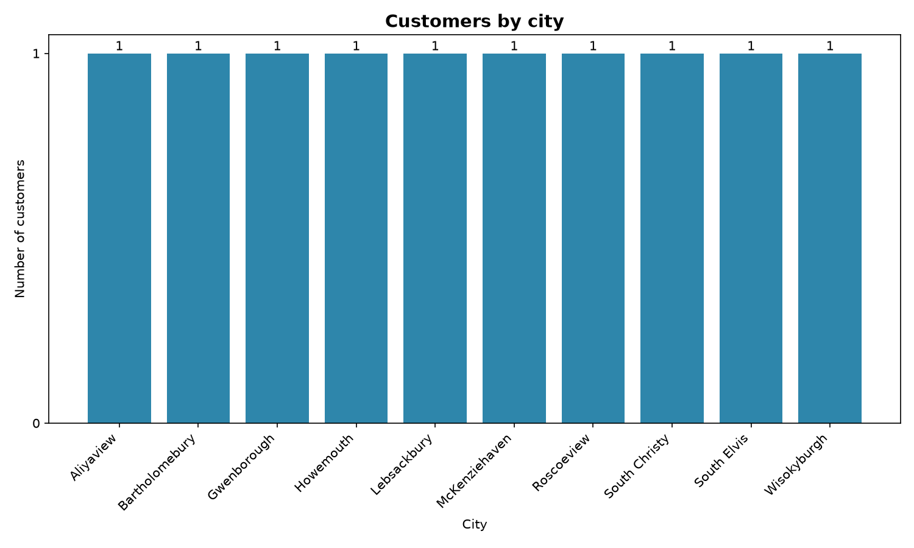
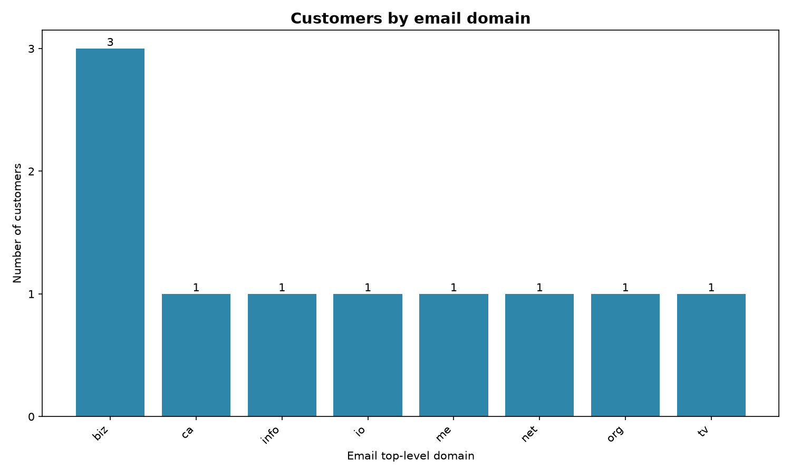

# Pesa Pulse: Customer Directory Analysis (Day 1)

An analysis of a partner's customer directory, retrieved from an API, to answer marketing's first question: **how many customers are there, where are they, and what does the data look like?**

The analysis is done twice: first with plain Python structures (dictionaries, sets, loops and comprehensions), then with pandas, which confirms the hand-written results.

## Project structure

```
day1-api-analysis/
├── analysis.py                          # all the code
├── output/
│   ├── customers.csv                    # one flat row per customer
│   ├── city_counts.csv                  # customers per city
│   ├── customer_distribution.png        # chart: customers by city
│   └── email_domain_distribution.png    # chart: customers by email domain
├── requirements.txt                     # libraries needed
└── README.md
```

## How to run

You need Python 3.10 or newer.

1. Clone the repository and open the folder:
   ```
   git clone https://github.com/Nicklausekim/day1-api-analysis.git
   cd day1-api-analysis
   ```
2. Create and activate a virtual environment:
   ```
   python -m venv venv
   venv\Scripts\activate          # Windows
   source venv/bin/activate       # macOS / Linux
   ```
3. Install the libraries:
   ```
   pip install -r requirements.txt
   ```
4. Run the analysis:
   ```
   python analysis.py
   ```

The findings print in the terminal, and the CSV files and charts are written to the `output/` folder (created automatically if missing). An internet connection is needed to reach the API.

## Approach

1. **Retrieve.** `get_customers()` requests the JSONPlaceholder Users API with a 10-second timeout and checks that the status code is 200. Timeouts, connection failures, bad status codes and invalid JSON each print a clear message and return an empty list instead of crashing.
2. **Explore.** `explore()` walks one customer record recursively and prints every key with its Python type, indented by depth.
3. **Extract.** `extract_attributes()` flattens each customer into one dictionary with 12 attributes. It uses `.get()` with defaults so missing fields don't crash the program, and converts latitude and longitude from text to floats.
4. **Unique cities.** `unique_cities()` uses a set comprehension, since a set keeps each city only once.
5. **Count.** `city_counts()` counts with a plain loop (no `Counter`, no pandas), and `email_domain_counts()` uses a dict comprehension. `sort_counts()` sorts both from most to least common, breaking ties alphabetically.
6. **pandas.** `to_dataframe()` builds a DataFrame with a fixed column order. `value_counts()` and `groupby().size()` were compared with the hand-written counts, and both matched exactly.
7. **Export.** `export_csvs()` writes both CSV files without the pandas index.
8. **Visualise.** `plot_distribution()` saves a titled, labelled bar chart with whole-number axes and readable tilted labels. It is used for both the city chart and the email-domain chart.

## The data structure

Each customer record has three nested dictionaries:

- `address`: street, suite, city, zipcode and `geo`
- `address.geo`: lat and lng (a dictionary inside `address`)
- `company`: name, catchPhrase and bs

The deepest attributes are latitude and longitude, two levels down:

```python
customer["address"]["geo"]["lat"]
customer["address"]["geo"]["lng"]
```

The API stores them as text, so they are converted to floats during extraction.

## Findings

1. **There are 10 customers, spread across 10 different cities.** Since no city has more than one customer, city-by-city regional campaigns would reach only one customer each. Marketing should group customers by a broader attribute, or wait for a larger dataset, before planning regional spend.
2. **`.biz` is the most common email domain**, used by 3 of 10 customers (30%). Every other domain (`.ca`, `.info`, `.io`, `.me`, `.net`, `.org`, `.tv`) appears once.
3. **The data is clean and complete.** Every customer has all 12 attributes, and pandas reproduced every hand-written count exactly.

## Which chart is more useful?





**The email-domain chart is more useful.** In the city chart every bar has the same height (one customer per city), so it shows no pattern and gives marketing nothing to prioritise. The email-domain chart shows a real difference: `.biz` stands out at 30% of customers.

An email domain is a weak signal, though. It hints at the *type* of customer (`.biz` addresses often suggest business users), not *where* they are. For regional planning, the partner will need to share more customers before city-level patterns can appear.

## Assumptions

- The task lists `id`, but the expected output names the column `customer_id`, so the ID is stored as `customer_id`.
- "Email domain" means the top-level domain only (e.g. `biz` from `Sincere@april.biz`), matching the expected output's `<tld>` and the starter's examples.
- Missing or unreadable coordinates are stored as NaN instead of stopping the program.
- All cities tie at one customer each, so "most common city" (Aliyaview) is chosen alphabetically and should not be read as a real hotspot.
- JSONPlaceholder is a mock API with made-up data, so the findings demonstrate the method rather than real customer patterns.